# MemoryCare

MemoryCare is an AI-powered customer-support demonstration that uses persistent customer history to retrieve relevant previous experiences, analyze uploaded support screenshots, and generate contextual responses. Hindsight provides the memory workflow, while Groq-backed vision and language models support screenshot analysis and response generation.

## Problem

Customer-support conversations often lose context between interactions. Customers may need to repeat the same issue and troubleshooting history. Remembering relevant prior experiences can help a support system respond with more useful context.

## Solution

MemoryCare connects screenshot diagnosis and customer support with persistent memory. Its demonstrated screenshot flow is:

**Customer issue → Screenshot → Vision diagnosis → Hindsight Recall → Personalized support → Resolution → Hindsight Retain**

Hindsight is central to retrieving relevant customer experiences before a response and storing a resolved support case for future recall.

## Key Features

- Persistent customer memory through Hindsight
- Hindsight Recall for customer-support context
- Hindsight Retain for resolved support cases
- Screenshot-based support diagnosis
- Vision extraction of error information visible in an uploaded image
- Personalized support based on the current issue and recalled context
- Customer 360 context in the Streamlit interface
- Human escalation preview containing the current diagnosis and prior AI recommendation
- User-triggered resolved-case learning

The current end-to-end demonstration focuses on a payment failure. Other support categories are possible extensions, not claims about tested or completed flows.

## Current Demo Scenario

- **Customer:** Bhavani
- **Product:** MemoryCare Mobile App
- **Issue:** Payment failure
- **Error code:** 4032
- **Amount:** ₹499
- **Previous successful troubleshooting:** Clearing the browser cache
- **Preferred language:** Telugu

This seeded customer history is the current demonstration scenario, not a limitation on the intended architecture.

## How Hindsight Is Used

### Recall

Before generating the screenshot-based support response, the application sends the Vision diagnosis to Hindsight Recall through its REST API. Hindsight returns relevant memories, which are passed to response generation.

For the demo, a current diagnosis containing Error 4032 can match a recalled experience that says the customer previously resolved that error by clearing the browser cache. The response logic uses that context when it is present; it does not treat the example as a result for every issue.

### Retain

After the user clicks **Save Resolved Case to Memory**, MemoryCare sends the case details and outcome to Hindsight through its REST API. Retain is not called automatically. The stored experience can then be considered by later Recall requests.

```text
Recall
  ↓
Personalized Response
  ↓
Resolve
  ↓
Retain
  ↓
Future Recall
```

## Architecture

```mermaid
flowchart TD
    subgraph Support_Question_Flow[Customer support question]
        Customer[Customer issue] --> UI[Streamlit UI]
        UI --> Agent[Support agent]
        Agent --> Recall[Hindsight Recall REST API]
        Recall --> TextModel[Groq text model]
        TextModel --> Response[Support response]
    end

    subgraph Screenshot_Flow[Screenshot support]
        Screenshot[Uploaded screenshot] --> Vision[Groq Vision model]
        Vision --> Diagnosis[Visible-information diagnosis]
        Diagnosis --> ScreenshotRecall[Hindsight Recall REST API]
        ScreenshotRecall --> Personalized[Personalized response generation]
    end

    subgraph Learning_Flow[Resolved case learning]
        Resolved[User marks case resolved] --> Retain[Hindsight Retain REST API]
        Retain --> Future[Future support context]
    end
```



The text-support flow uses `support_agent()`, which performs Recall and then response generation. Screenshot support calls Vision, Recall, and response generation directly from the Streamlit flow. Both Recall and Retain are implemented in `memory.py` using HTTP requests to Hindsight's REST API; this project does not use `hindsight-client`.

## Tech Stack

- Python
- Streamlit
- Hindsight REST API
- Requests
- Groq Python SDK
- Groq Vision model: `qwen/qwen3.8-27b`
- Groq text model: `openai/gpt-oss-120b`
- `python-dotenv`

## Project Structure

| File | Purpose |
| --- | --- |
| `app.py` | Streamlit interface, screenshot workflow, memory display, and case-save interaction |
| `memory.py` | Hindsight Recall and Retain REST wrapper |
| `agent.py` | Connects a support question to Recall and response generation |
| `vision.py` | Sends uploaded image content for screenshot analysis |
| `llm.py` | Generates support responses using recalled context and the current issue |
| `seed_memory.py` | Stores the demonstration customer history in Hindsight |
| `memory_demo.py` | Demonstrates a direct memory Recall query |
| `personalized_test.py` | Exercises a personalized response through the support agent |
| `agent_test.py` | Exercises the support-agent flow |
| `groq_test.py` | Checks Groq text-model connectivity |
| `.env.example` | Placeholder environment-variable template |
| `.gitignore` | Excludes local credentials, virtual environments, and Python bytecode |
| `requirements.txt` | Runtime Python dependencies |

The optional scripts may call configured external services. `seed_memory.py` writes to the selected Hindsight bank; run it only when you intend to seed the demo history.

## Setup

In Windows PowerShell:

```powershell
git clone <repository-url>
Set-Location "Memory core"

python -m venv .venv
.\.venv\Scripts\Activate.ps1
python -m pip install -r requirements.txt

Copy-Item .env.example .env
```

Open `.env` and add your own values for `HINDSIGHT_API_KEY`, `HINDSIGHT_BASE_URL`, `HINDSIGHT_BANK_ID`, and `GROQ_API_KEY`. The example file contains placeholders only. Never commit `.env` or share its credential values.

If you want the current demonstration history in your configured Hindsight bank, run the seed script once:

```powershell
python seed_memory.py
```

## Run

```powershell
streamlit run app.py
```

The app opens a Streamlit dashboard with Customer 360, support and memory tools, and a screenshot diagnosis workflow. Upload a supported image to run Vision analysis, Recall, and personalized response generation. The resolved-case Retain operation runs only when its button is clicked.

## Demo Flow

1. Open MemoryCare and review Customer 360.
2. Upload a customer-support screenshot.
3. Run Vision Diagnosis.
4. Review the Hindsight Recall status and any returned context.
5. Read the personalized support response.
6. Compare the generic and memory-informed examples.
7. Click **Save Resolved Case to Memory** after resolution.
8. Review the Retain confirmation.
9. Explain that the new experience can be considered by future Recall requests.
10. Open Human Escalation Preview if needed.

## Why Memory Matters

Without memory, a response may be generic. With relevant recalled context, a response can take prior customer experience, a previously successful troubleshooting step, or a stored preference into account. The result depends on what Hindsight returns for the current query; this project makes no quantitative performance claim.

## Limitations

- The current demonstrated end-to-end scenario is a payment failure.
- Screenshot understanding depends on information visible in the uploaded image.
- The demonstrated customer history is seeded/demo data in Hindsight.
- The human escalation section is a preview; it does not dispatch a real support ticket.
- Additional customer-support categories and workflows can be expanded in future versions.

## Future Scope

Potential extensions, not current feature claims:

- More support issue categories
- More customer histories
- Additional product and order context
- Broader multilingual support
- Integration with a human-agent workflow
- Additional feedback-driven learning
- More types of support evidence

## Security

- Local API credentials belong in `.env`.
- `.env` is excluded by `.gitignore`.
- `.env.example` contains placeholders only.
- Never commit `.env`, API keys, tokens, passwords, or other credentials.
